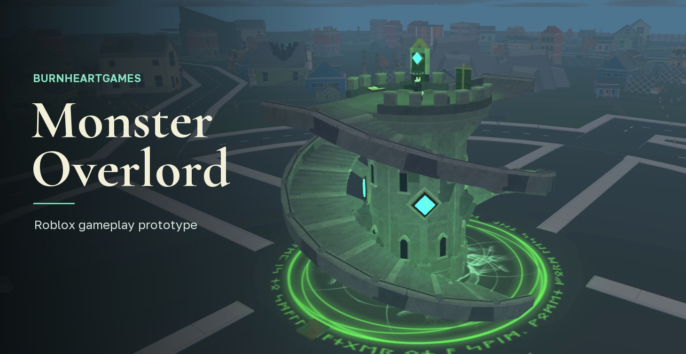
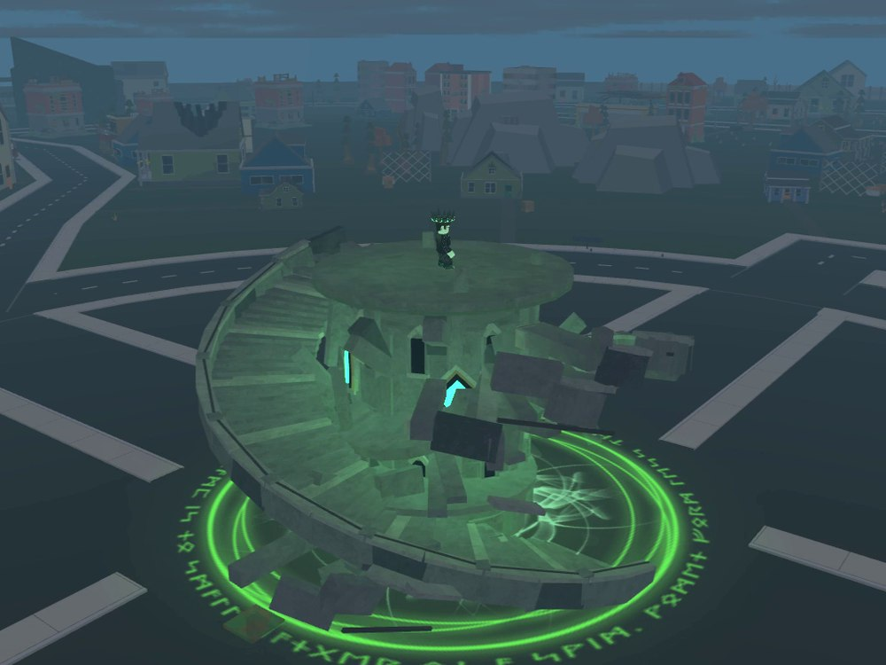
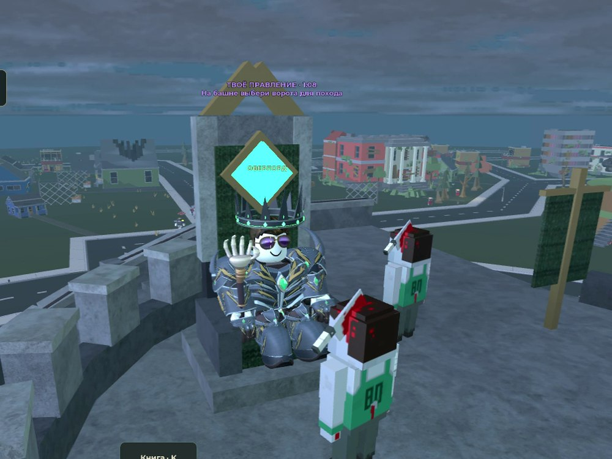
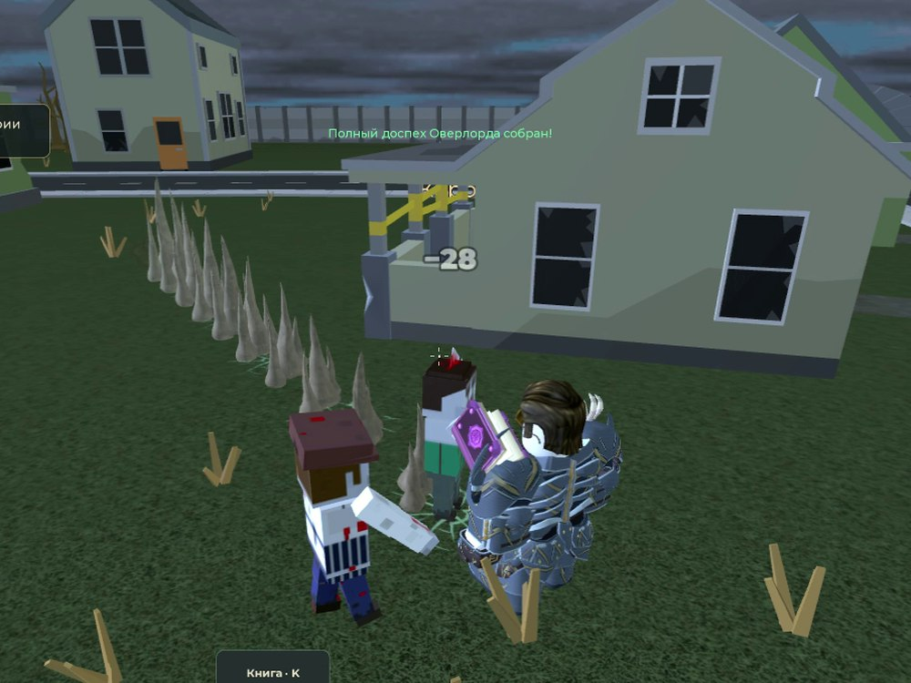
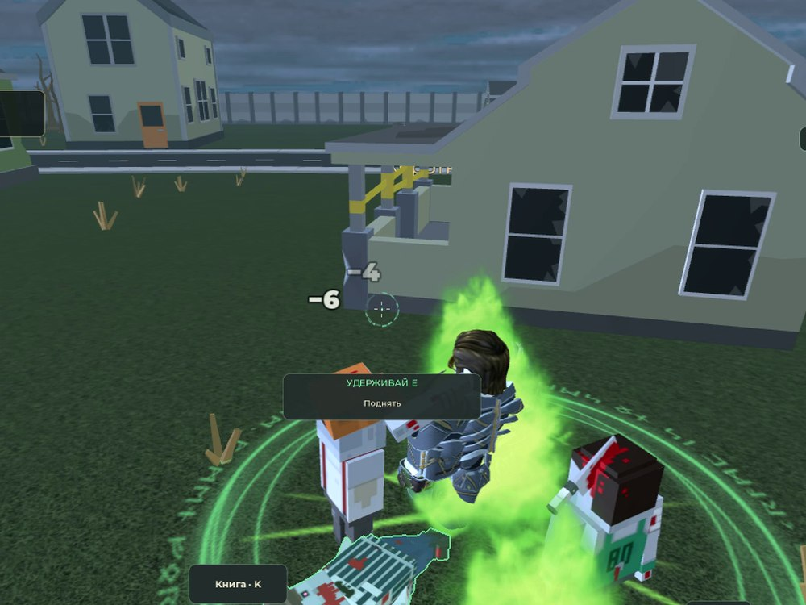

# Monster Overlord

<picture>
  
</picture>

**A Roblox gameplay prototype by BurnHeartGames.** Fight with a staff and spells, raise defeated enemies, and lead your undead squad in a race for the Crown. Claiming it raises a fortress that gives you a steady supply of recruits and gives rivals a new target.

[Watch the 9-second tower assembly](https://github.com/Incube700/monster-overlord-showcase/raw/refs/heads/main/media/MonsterOverlord-Tower-Take.mp4) · [Game Design Document](docs/GDD.md) · [Architecture](docs/ARCHITECTURE.md) · [Playtest Notes](docs/PLAYTEST.md)

## Gameplay loop

| Stage | What the player does | What it lets them do next |
| --- | --- | --- |
| Raise a squad | Fight for souls and raise fallen enemies | Order recruits to attack, follow, or hold ground |
| Get stronger | Clear camps and pick up armor pieces and spell pages | Take harder fights with new tools and a stronger squad |
| Claim the Crown | Win the central encounter and hold the Crown site | Raise the tower, recruit Walkers at the throne, and start a siege |
| Steal a crystal | Send a lich to break a rival seal, then carry the trophy home | End the reign through ascension or keep the Crown and continue |

## From Roblox Studio

<table>
  <tr>
    <td width="50%"> <strong>Tower assembly</strong> The upper platform rises as the walls and stairs come together.</td>
    <td width="50%"> <strong>Throne and recruits</strong> While the Overlord sits, a Walker joins every six seconds if the army and rooftop have room.</td>
  </tr>
  <tr>
    <td width="50%"> <strong>Bone Rift</strong> Spikes trace the strip used to resolve the spell hit.</td>
    <td width="50%"> <strong>Raising a Walker</strong> A fallen enemy becomes a recruit the player can command.</td>
  </tr>
</table>

The tower clip uses original frames from a fixed-camera Studio test. Playback is sped up. The gallery also includes frames from combat and throne playtests.

## Engineering

| System | Responsibility |
| --- | --- |
| Hero combat and spells | Accept combat intent, check it on the server, and send confirmed hit and effect events |
| Army and corpses | Track actors, ownership, follow/attack/hold orders, soul costs, and recruit capacity |
| Crown and siege | Track the reigning player, build the tower, recruit Walkers, handle lich seals and crystal delivery |
| Presentation | Render armor, spells, creature feedback, and the HUD on the client |
| Playtest logging | Record reign outcomes, time on the throne, recruitment, and delivered crystals in Studio |

The [architecture overview](docs/ARCHITECTURE.md) traces a spell from input to feedback and a reign from claiming the Crown to teardown. The [GDD](docs/GDD.md) documents the player decisions and the proposed winged return to the hub.

## Project snapshot

| Field | Details |
| --- | --- |
| Engine | Roblox Studio · Luau |
| Status | r9 development playtest |
| Setting | A city with five crypt districts and a shared Crown site |
| My role | Independent game design, gameplay scripting, and playtest iteration |
| Portfolio contents | Design and engineering notes, rendered screenshots, and the tower clip |

Game design and development by Siarhei Ivanou / BurnHeartGames. The game uses third-party art alongside project assets. This showcase contains rendered portfolio material and documentation.

## Also by BurnHeartGames

**Final Pressure** is my released Unity WebGL horde survival game. Build up weapons and support tools, capture specialist sites, and defeat the Commander. [GitHub showcase](https://github.com/Incube700/final-pressure-showcase) · [Play on itch.io](https://burnheartgames.itch.io/final-pressure)
