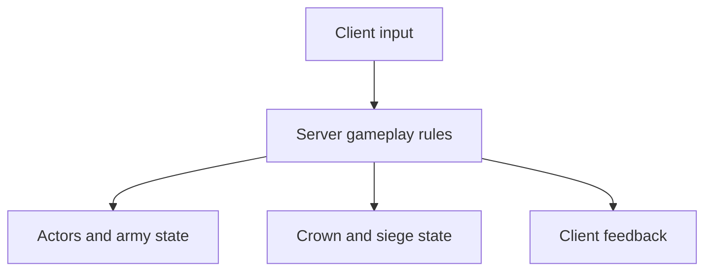

# Architecture

Monster Overlord r9 runs its rules in Luau on the Roblox server. The client owns input and presentation. This overview follows the build used for the showcase.

## Runtime boundaries

| Area | Modules in r9 | Responsibility |
| --- | --- | --- |
| Gameplay orchestration | `NecromancerServer` | Connects combat, actors, recruitment, progression, and the Crown session |
| Actors and squad behavior | `ActorRegistry`, `ActorFactory`, `ArmyOrders`, `ArmyRally` | Track living actors and their owners, construct recruits, and coordinate orders and rally points |
| Combat example | `BoneRift`, `BoneRiftView` | The server resolves the ground path and damage. The client renders rising spikes along the confirmed strip |
| Crown and siege | `CrownAuthority`, `CrownReign`, `CrownSiege`, `CrownThroneChallenge` | Handle claim and ownership, one active reign, siege progression, and the challenge at the throne |
| World and rewards | `CrownSiegeTower`, `CrownCryptSeals`, `CrownSiegeRelics` | Build the tower, manage access at crypt seals, and track crystal pickups and deliveries |
| Player-facing state | `NecromancerClient`, `HUDView`, `CreatureRenderer` | Read inputs, display army and spell state, and present creatures |

## Combat from input to feedback

1. The player aims a Bone Rift cast at the ground.
2. The server checks the caster, range, and cooldown. It traces the walkable strip and stops the path at an obstruction.
3. The server resolves eligible enemies inside that strip. It sends the confirmed points to the client for the spike animation.
4. On a kill, a soul or an eligible corpse becomes part of the next player decision. Corpse ownership, soul cost, and remaining squad capacity are checked when recruiting.

A spell can be checked both in combat and as a visual. The test can verify a hit against a concrete target, then inspect whether the effect follows the same line.

## What a reign owns

| State | Rule that matters |
| --- | --- |
| Claim | The Crown checks the contestant and a completed hold before giving them the reign |
| Tower | The current reign creates the raised platform, stairs, throne, and siege controls |
| Recruit | A seated ruler can gain one Walker on a six-second interval. Full army slots or an occupied spawn area skip that recruit |
| Siege | One route is active for the reign. A lich opens the chosen seal, and the Overlord picks up and delivers the actual crystal |
| Exit | Defeat, leaving, abdication, or ascension ends ownership and clears the tower. Units on the upper level have a route back to ground level |

The Studio reign summary contains duration, end reason, time on the throne, recruits, skipped recruit attempts, and delivered crystals. These signals let a playtester compare routes and see why a run ended. [Playtest notes](PLAYTEST.md)
